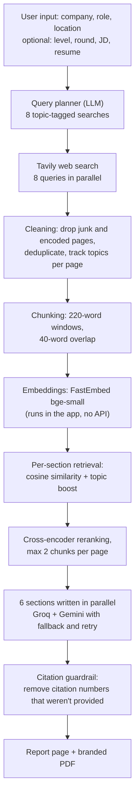

# HappyInterviews

**AI interview prep that shows its sources.** Enter a company, role and location, and HappyInterviews researches the live web and writes a six-part prep report: company snapshot, interview process, likely questions, talking points, questions to ask the interviewer, and a prep checklist. Every web-based fact links to the page it came from.

**Live app:** [happyinterviews.streamlit.app](https://happyinterviews.streamlit.app)


## Why it exists

Asking a general chatbot "help me prepare for my Swiggy interview" gets you generic advice with no way to check it. HappyInterviews is a retrieval-augmented generation (RAG) system built around one rule: **company-specific facts must come from a source you can click.** Each point in the report carries one of three labels:

| Label | Meaning |
|---|---|
| **Source** | Taken from a web page, with a numbered citation that opens it |
| **Your profile** | Based on the resume or job description the user provided |
| **AI tip** | General advice written by the model, with no citation |

## Features

- **Live web research:** an LLM plans 8 targeted searches per report, tagged by topic (company, news, interview process, questions, culture, role skills)
- **Six-section report** written in parallel, with clickable citations and a branded **PDF download**
- **Personalization:** experience level, interview round, pasted job description, and resume PDF. The resume never reaches the web search and personal reports are never cached.
- **Honest gaps:** sections with too few sources are told to say so instead of guessing
- **Free-tier design:** sections are spread across several Groq and Gemini models, with per-model cooldowns, fallback and an automatic retry
- **Built-in evaluation dashboard** with an AI judge (see [Evaluation](#evaluation))

## How it works



### Key design decisions

| Decision | Why |
|---|---|
| **Search-time retrieval instead of a fixed document store** | Interview processes and company news change constantly; a stale index would give stale advice |
| **Query planner with topic tags** | One generic search returns company homepages. Tagged searches (process, questions, culture...) feed each section the material it needs, and a small score boost favors chunks from the right searches. Fixed templates fill in if the planner fails. |
| **Two-stage retrieval: bi-encoder, then cross-encoder** | The embedding model scores every chunk quickly; the cross-encoder reads query and chunk together and re-ranks only the top 20, trading a little speed for precision |
| **Source diversity cap (2 chunks per page)** | Without it, one long page could fill every slot for a section |
| **FastEmbed + NumPy instead of a RAG framework** | The framework pulled in hidden NLTK downloads that failed on the host. The replacement is a short, dependency-light module where every step is explicit. |
| **Batched embedding (16 at a time)** | Embedding 150+ chunks in one batch exceeded the free host's memory and crashed the app |
| **Many models, per-model cooldowns** | Free-tier limits are per model. Sections are spread across several models, each model takes at most two requests at a time, and a rate-limit error pauses only that model for as long as the error asks. The first evaluation run showed that splitting across just two providers wasn't enough. |
| **Citation guardrail** | Models sometimes cite source numbers that don't exist; these are removed so every citation points to a real, provided page |
| **Privacy by design** | The resume and JD only enter the writing prompts that need them, never the search queries, and reports that use them are excluded from the shared 24-hour cache |

## Evaluation

The app includes a password-protected evaluation dashboard (`/?eval=1`) that runs the full pipeline on a fixed set of **15 test cases** across industries (tech, consulting, banking, startups), experience levels, interview rounds, and two companies with very little public information.

**Method**
- **Citation accuracy:** an AI judge reads each Source-tagged claim next to the text of the page it cites and labels it *supported*, *partial*, or *unsupported*
- **Cross-model judging:** each claim is judged by a different model than the one that wrote it, so no model grades its own output
- **Retrieval relevance:** the judge rates each retrieved passage as useful or not for its section, with the reranker **on vs. off** on the same pages
- **Human check:** a sample of judge verdicts is reviewed by hand to measure how far the judge can be trusted

**First run: 5 of 15 cases**

| Measured | Result |
|---|---|
| Median time to build a report | 24.2 s (slowest 28.2 s) |
| Web pages read per report | 16 to 26 |
| Report points tagged as web-sourced (completed sections) | 76% |
| Sections completed | 9 of 30 |
| Source-tagged points with a citation number | 27 of 76 |
| Claims the judge could grade | 1 of 27 |

**What the evaluation found.** The first run surfaced problems that manual testing had missed, which is the point of running it:

1. **Provider failures in the deployed app.** Every section routed to Gemini failed, and the fallback to Groq then hit Groq's free-tier rate limit, because six sections were being written at the same time. 21 of 30 sections failed even after the retry.
2. **The judge was blocked by the same limits.** Only 1 of 27 claims could be graded, so citation accuracy and retrieval relevance were not measured on this run.
3. **Missing citations.** 49 of 76 Source-tagged points had no citation number, so the tag promised a source the reader couldn't open.
4. **The limited-information flag never triggered.** It counts retrieved passages, and retrieval always returns some, even for a small company like Sigmoid.

**Fixes made after the first run**
- **Spread across models, not just providers:** free-tier limits apply per model, so sections are now spread over up to three Groq models and three Gemini models, with at most two requests per model at a time
- **Cooldowns from the error itself:** a rate limit that says "try again in 1.2s" pauses only that model for 1.2 seconds; a model with no quota (for example, a Gemini model with a free-tier limit of 0) is parked for an hour instead of being retried on every call
- **Citation repair:** unusual citation formats are normalized, and a Source-tagged point left without a valid citation is shown as an AI tip
- **Judging by a different model:** claims are judged by a different model than the one that wrote them, even when only one provider is available

**Still to do**
- Base the limited-information flag on relevance scores instead of passage count
- Rerun all 15 cases and report citation accuracy and the reranker comparison

## Tech stack

| Layer | Tools |
|---|---|
| App and UI | Streamlit with a custom design layer (CSS, HTML components) |
| Web search | Tavily |
| LLMs | Groq (open-weight models) and Google Gemini, free tiers |
| Embeddings and reranking | FastEmbed: `BAAI/bge-small-en-v1.5` and `ms-marco-MiniLM-L-6-v2` cross-encoder |
| Vector search | NumPy cosine similarity (in memory, per report) |
| Documents | pypdf (resume reading), ReportLab (PDF export) |
| Hosting | Streamlit Community Cloud |

## Project structure

```
happy-interviews/
├── app.py                 # main page: inputs, progress, report view
├── core/
│   ├── pipeline.py        # the full pipeline, shared by app and evaluation
│   ├── planner.py         # LLM query planner with template fallback
│   ├── search.py          # parallel Tavily search, cleaning, dedup
│   ├── rag.py             # chunking, embedding, retrieval, reranking
│   ├── generate.py        # section prompts, citation guardrail, parallel writing, retry
│   ├── llm.py             # Groq + Gemini with load split and fallback
│   ├── profile.py         # level, round, JD and resume handling
│   ├── sections.py        # search topics and report sections
│   └── pdf_report.py      # branded PDF export
├── ui/theme.py            # design tokens, stylesheet, HTML components
├── evaluation/            # test cases, AI judge, runner, dashboard
└── docs/                  # screenshot of the live app
```

## Run your own copy

1. Fork this repository.
2. Get free API keys from [Tavily](https://tavily.com), [Groq](https://console.groq.com) and [Google AI Studio](https://aistudio.google.com).
3. Deploy on [Streamlit Community Cloud](https://share.streamlit.io) with `app.py` as the main file, and add these secrets:
   ```toml
   TAVILY_API_KEY = "..."
   GROQ_API_KEY = "..."
   GEMINI_API_KEY = "..."
   EVAL_PASSWORD = "..."   # protects the evaluation page
   ```
4. Optional: add `?debug=1` to the URL to see search plans, retrieved chunks and per-section model details.

## Limitations

- Results depend on what is publicly written about a company; small companies get thinner reports (flagged in the report)
- Some interview-review sites block automated access, so candidate experiences come from pages that allow it
- The AI judge is itself a model; the human check measures how far its verdicts can be trusted
- Free-tier rate limits currently cause section failures under load (see [Evaluation](#evaluation))

## Author

Built by **Shubham Bokolia**, Master of Management (Business Analytics), IISc Bangalore.
